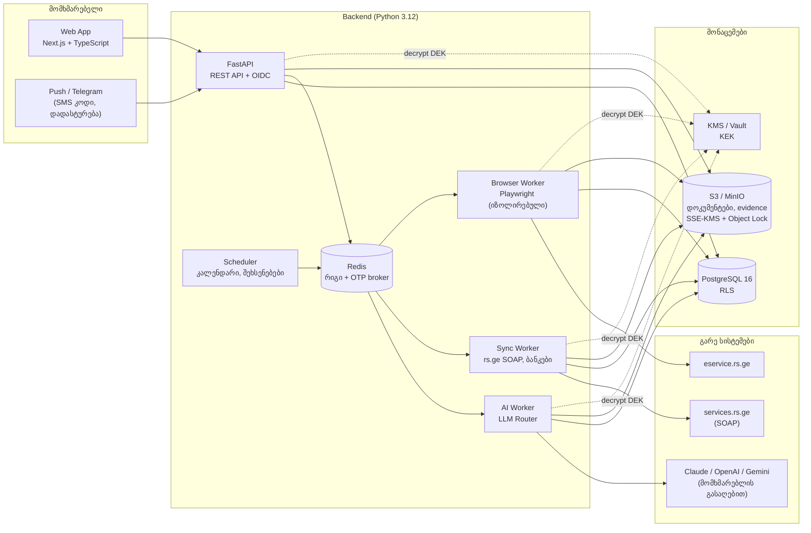
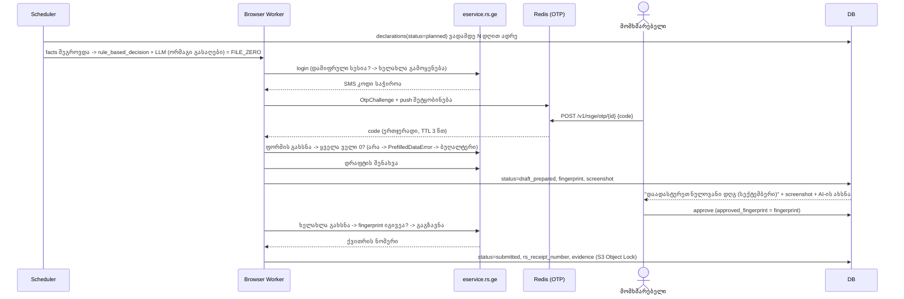

# AI-ბუღალტერი — სისტემის არქიტექტურა

> SaaS პლატფორმა, რომელიც ავტომატურად ასრულებს ბუღალტრის რუტინულ სამუშაოს და მართავს
> eservice.rs.ge-ს პროცესებს. მომხმარებელი იყენებს **საკუთარ** LLM გასაღებს (Claude / ChatGPT / Gemini).

## 0. ძირითადი პრინციპები

| # | პრინციპი | რას ნიშნავს პრაქტიკაში |
|---|----------|-------------------------|
| 1 | **LLM გვთავაზობს → კოდი ამოწმებს → ადამიანი ადასტურებს** | LLM კითხულობს დოკუმენტებს და გვთავაზობს კლასიფიკაციას. არითმეტიკას, ფორმატებს და ლოგიკას ამოწმებს დეტერმინისტული კოდი. rs.ge-ზე **არაფერი იგზავნება** მომხმარებლის ცალსახა დადასტურების გარეშე (DB-ის დონეზეც დაცულია). |
| 2 | **ოფიციალური API > ბრაუზერის ავტომატიზაცია** | ზედნადებები/ანგარიშ-ფაქტურები — rs.ge SOAP სერვისებით ("სერვისის მომხმარებელი"). Playwright მხოლოდ იქ, სადაც API არ არსებობს (დეკლარაციები). |
| 3 | **უსაფრთხოების მექანიზმებს გვერდს არ ვუვლით** | 2FA (SMS) — მომხმარებელი თავად გვაწვდის კოდს (human-in-the-loop). CAPTCHA — ავტომატიკა ჩერდება. |
| 4 | **BYOK (Bring Your Own Key)** | LLM-ის ხარჯი და ხელშეკრულება პროვაიდერთან მომხმარებლისაა. გასაღები ინახება დაშიფრულად, არასდროს ბრუნდება API-დან. |
| 5 | **ყველაფერი აუდიტირებადია** | append-only audit log (hash chain), screenshot-ები + Playwright trace ყოველ rs.ge ოპერაციაზე. |

---

## 1. მაღალი დონის არქიტექტურა



**რატომ ცალკე Browser Worker:** Chromium დიდი შეტევის ზედაპირია. ის ეშვება ცალკე კონტეინერში,
egress მხოლოდ `*.rs.ge`-ზე, inbound პორტების გარეშე, თითო ამოცანაზე ახალი browser context
(ერთი tenant-ის cookies მეორეში ვერ მოხვდება).

---

## 2. ტექნოლოგიური სტეკი

| ფენა | არჩევანი | რატომ |
|------|----------|-------|
| ენა (backend) | **Python 3.12** | Playwright-ის სრულფასოვანი Python API, `zeep` (SOAP), Pydantic (LLM structured output-ის ვალიდაცია), openpyxl/pandas (Excel ამონაწერები). |
| API | **FastAPI** | async, Pydantic-ზე დაფუძნებული ვალიდაცია, OpenAPI სქემა ფრონტენდისთვის. |
| rs.ge ავტომატიზაცია | **Playwright** (Puppeteer-ის ნაცვლად) | auto-wait, `codegen` სელექტორების ჩასაწერად, **tracing** (აუდიტისთვის ნაბიჯ-ნაბიჯ ჩანაწერი), storage_state (სესიის ხელახალი გამოყენება). |
| SOAP | **zeep** | WSDL-დან ავტომატური კლიენტი (WayBillService და სხვ.). |
| LLM | ოფიციალური SDK-ები: `anthropic`, `openai`, `google-genai` | structured output სამივეზე (JSON Schema); ერთიანი `LLMRouter` ინტერფეისი. |
| DB | **PostgreSQL 16** | Row Level Security (multi-tenant), `numeric` თანხებისთვის, `jsonb` LLM-ის output-ისთვის, constraint trigger-ები (ბალანსი, დადასტურება). |
| რიგი / worker-ები | MVP: **Redis + ARQ/Celery**; მასშტაბზე: **Temporal** | დეკლარაციის ნაკადი საათობით/დღეობით ელოდება ადამიანს (SMS, დადასტურება) — Temporal ამას ბუნებრივად უმკლავდება (durable workflows). |
| ფაილები | **S3** (ან MinIO) | SSE-KMS; evidence bucket — **Object Lock (WORM)**. |
| საიდუმლოებები | **AWS KMS / GCP KMS / HashiCorp Vault Transit** | envelope encryption; KEK არასდროს ტოვებს HSM-ს. |
| Frontend | **Next.js (React) + TypeScript**, shadcn/ui, ქართული i18n | SSR, ფორმები, დოკუმენტების preview, დადასტურების ეკრანი (screenshot + AI-ის ახსნა). |
| ავთენტიფიკაცია | **OIDC** (Keycloak / Auth0 / Cognito) + **სავალდებულო MFA** | owner/accountant როლებისთვის MFA სავალდებულოა — ეს ანგარიში rs.ge-ზე დეკლარაციებს აგზავნის. |
| დაკვირვებადობა | OpenTelemetry, Sentry (PII scrubbing), Prometheus/Grafana | rs.ge "canary" ტესტების ალერტები, LLM-ის ხარჯი/შეცდომები პროვაიდერების მიხედვით. |

---

## 3. კოდის რუკა (ეს რეპოზიტორია)

```
backend/
  app/
    config.py                  პარამეტრები (APP_* გარემოს ცვლადები)
    security/crypto.py         envelope encryption (AES-256-GCM + KMS), AAD tenant-ზე მიბმით
    security/redaction.py      ლოგებიდან გასაღებების/პაროლების ამოღება (uvicorn access log-ის ჩათვლით)
    security/oidc.py           OIDC: JWT + JWKS ვერიფიკაცია (მხოლოდ ასიმეტრიული ალგორითმები), MFA (`amr`)
    llm/router.py              LLMRouter: ვალიდაცია, repair, retry, fallback
    llm/schema.py              Pydantic -> "strict" JSON Schema (სამივე პროვაიდერისთვის)
    llm/providers/*.py         Claude / ChatGPT / Gemini ადაპტერები (ოფიციალური SDK)
    accounting/models.py       დომენის მოდელები (ExtractedDocument, DeclarationDecision, ...)
    accounting/validation.py   დეტერმინისტული შემოწმებები (დღგ 18%, ჯამები, საიდ. კოდი)
    accounting/ai_accountant.py  დოკუმენტის დამუშავება + დეკლარაციის "ორმაგი გასაღები"
    accounting/tax_calendar.py ვადები + საქართველოს უქმე დღეები (აღდგომის ჩათვლით)
    accounting/reporting.py    მფლობელის ანგარიში + ჰალუცინირებული ციფრების დეტექტორი
    rsge/browser.py            Playwright: login, 2FA, ნულოვანი დეკლარაცია (2 ფაზა)
    rsge/selectors.py          ⚠️ სელექტორები — ჩასანაცვლებელია რეალური DOM-ით
    rsge/otp.py                SMS კოდის human-in-the-loop broker (Redis)
    rsge/soap.py               WayBillService კლიენტი (სერვისის მომხმარებელი)
    services/llm_keys.py       BYOK: გასაღების შემოწმება, დაშიფვრა, შენახვა, ნაგულისხმევი, გაუქმება (კრიპტო-წაშლა)
    services/llm_usage.py      LLM ხარჯის აღრიცხვა (llm_calls) და შეჯამება
    services/consents.py       თანხმობები (ai_processing და სხვ.) - ვერსია, IP, აუდიტი
    services/declarations.py   დეკლარაციების სია/ისტორია, ადამიანის დადასტურება fingerprint-ზე
    api/deps.py                ავთენტიფიკაცია (oidc | dev), როლი tenant_members-იდან
    api/middleware.py          X-Request-Id (ლოგების კორელაცია), მოთხოვნის ზომის ლიმიტი
    api/routes.py              REST endpoint-ები
    db/migrations/*.sql        PostgreSQL სქემა მიგრაციებად (RLS, ტრიგერები, სტატუსების მანქანა, აუდიტის ჯაჭვი)
    db/migrate.py              მიგრაციების გამშვები (checksum, advisory lock, ტრანზაქცია ფაილზე)
    services/taxpayers.py      გადამხდელები; rs.ge პაროლი და სესია (დაშიფრული), invalid -> ხელახლა არ ვცდით
    services/planning.py       კალენდარი -> planned დეკლარაციები (ყოველდღიური cron)
    services/rsge_otp.py       SMS-ის მოთხოვნები UI-სთვის (კოდი DB-ში არ ინახება)
    workflows/declaration_flow.py  prepare/submit: DB <-> Playwright <-> ადამიანი, automation_runs, evidence
    worker.py                  ARQ worker (max_tries=1 rs.ge-ზე), cron Asia/Tbilisi დროით
  tests/                       110 ტესტი (E2E: API + worker + Chromium ყალბ პორტალზე, PostgreSQL, Redis, OIDC)
```

---

## 4. მთავარი ნაკადები

### 4.1 LLM გასაღების დამატება (BYOK)

```mermaid
sequenceDiagram
  actor U as მომხმარებელი
  participant API
  participant P as LLM პროვაიდერი
  participant KMS
  participant DB as PostgreSQL
  U->>API: POST /v1/llm/credentials {provider, api_key, model?}
  API->>P: GET /models (იაფი შემოწმება)
  P-->>API: მოდელების სია / 401
  API->>API: DEK = random(256); ct = AES-GCM(DEK, key, AAD=tenant|purpose|id)
  API->>KMS: wrap(DEK, AAD)
  API->>DB: INSERT llm_credentials (ct, wrapped_dek, key_hint="…Xy9Z") + audit_log
  API-->>U: {id, provider, model, key_hint, available_models}
```

* სრული გასაღები უკან **აღარასდროს** ბრუნდება — UI აჩვენებს მხოლოდ `…Xy9Z`.
* მოდელების სია მოდის პირდაპირ პროვაიდერიდან → UI-ში ყოველთვის აქტუალური მოდელებია.
* fallback სხვა პროვაიდერზე — მხოლოდ tenant-ის ცალსახა თანხმობით (`consents.llm_fallback_other_provider`).

### 4.2 დოკუმენტის დამუშავება (OCR + LLM Vision)

1. ატვირთვა → S3 + `documents` (sha256 — დუბლიკატი ორჯერ არ მუშავდება).
2. ტიპის ამოცნობა magic bytes-ით; Excel → CSV ტექსტი (LLM-ები xlsx-ს ნატიურად არ იღებენ).
   ცნობილი ბანკების ამონაწერები → დეტერმინისტული პარსერი (LLM არ სჭირდება).
3. `LLMRouter.structured(output_model=ExtractedDocument)` — PDF/სურათი პირდაპირ მოდელს
   (სამივე პროვაიდერს აქვს vision/PDF). ცალკე OCR (Tesseract `kat`) — მხოლოდ ცუდი ხარისხის
   სკანირებისას, როგორც მეორე წყარო.
4. Pydantic ვალიდაცია; ჩავარდნისას — ერთი "repair" მცდელობა შეცდომის ტექსტით.
5. `validate_extracted_document`: საიდ. კოდის ფორმატი, ჩვენი კომპანია მყიდველი/გამყიდველია,
   ჯამები, დღგ = 18% (ან 18/118), ანგარიშები არსებობს ანგარიშთა გეგმაში.
6. `errors` ან `confidence < 0.9` → `needs_review` (ბუღალტრის რიგი). სხვა შემთხვევაში —
   draft გატარება (`journal_entries.status='draft'`), რომელსაც ადამიანი ადასტურებს.
7. ბუღალტრის შესწორებები ინახება (`document_extractions.corrections`) → eval ნაკრები.

### 4.3 ნულოვანი დეკლარაცია (ორფაზიანი, SMS კოდით)

რეალიზაცია: `workflows/declaration_flow.py` (worker, ARQ). UI SMS-ის მოთხოვნას ხედავს
`GET /v1/rsge/otp/pending`-ით (worker-ი challenge-ს `otp_challenges`-ში იწერს; კოდი - მხოლოდ Redis-ში).
ერთ გადამხდელზე ერთდროულად ერთი ბრაუზერის სესია (`automation_runs_one_active`); crash-ის შემდეგ
"გაჭედილი" გაშვება 30 წუთში თავისუფლდება (`stale`). rs.ge-ს მიუწვდომლობა = `portal_unavailable`
(ხელახლა ცდა `/prepare` ან `/submit`-ით), არასწორი პაროლი = მონაცემები `invalid` (ავტომატიკა აღარ ცდის).



დაცვის ფენები:

* **ორმაგი გასაღები:** `FILE_ZERO` მხოლოდ თუ დეტერმინისტული წესები *და* დამოუკიდებლად
  გაშვებული LLM ერთსა და იმავეს ამბობენ, LLM-ის confidence ≥ ზღვარი. სხვაგვარად → ბუღალტერი.
* **prefill შემოწმება:** rs.ge დღგ-ს დეკლარაციას ავსებს ანგარიშ-ფაქტურებიდან. თუ ფორმაში
  არანულოვანი ველია — ნულოვანი დეკლარაცია არასწორი იქნება → ჩერდება.
* **fingerprint:** მომხმარებელი ადასტურებს კონკრეტულ ფორმას; თუ დადასტურებასა და გაგზავნას
  შორის rs.ge-ზე რამე შეიცვალა → `FingerprintMismatchError`.
* **idempotency:** გაგზავნამდე მოწმდება, ხომ არ არის უკვე წარდგენილი (queue retry ≠ ორმაგი დეკლარაცია).
* **DB constraint:** `declarations.status IN ('approved','submitting','submitted')` შეუძლებელია
  `approved_by` + `approved_fingerprint = form_fingerprint`-ის გარეშე.
* **სტატუსების მანქანა (ტრიგერი):** `approved` მხოლოდ `draft_prepared`/`awaiting_approval`-დან,
  `submitting` მხოლოდ `approved`-დან (ან `failed`-დან, თუ დადასტურება ისევ ვალიდურია), `submitted` მხოლოდ
  `submitting`-დან; `submitted` და `cancelled` საბოლოოა (ქვითარი/ფორმა/დადასტურება აღარ იცვლება);
  ჩანაწერი `approved` სტატუსით ვერ შეიქმნება. worker-ის ბაგიც ვერ "გამოტოვებს" ადამიანს.
* **API-ს დადასტურება** (`POST /v1/declarations/{id}/approve`) იღებს იმ `fingerprint`-ს, რაც მომხმარებელმა
  ეკრანზე ნახა; თუ worker-მა ამასობაში ფორმა ხელახლა მოამზადა -> `409 form_changed`.
* **არასწორ პაროლზე/SMS კოდზე ხელახლა არ ვცდით** — ანგარიშის დაბლოკვის რისკი.

"ავტომატური წარდგენა" (დადასტურების გარეშე) შეიძლება ჩაირთოს მხოლოდ tenant-ის ცალსახა,
ცალკე ხელმოწერილი თანხმობით (`tenants.settings.auto_submit_zero`) და მხოლოდ ნულოვან
დეკლარაციებზე — მაგრამ ამ შემთხვევაშიც DB მოითხოვს approval ჩანაწერს: `approved_by` = მფლობელი,
რომელმაც ეს თანხმობა გასცა, ხოლო `declaration_events`-ში მოვლენა ჩაიწერება `actor_type='system'`-ით,
რათა აუდიტში ჩანდეს, რომ დადასტურება წესით მოხდა.

### 4.4 ყოველთვიური ციკლი

| დღე | ქმედება |
|-----|---------|
| 1–3 | ანგარიშ-ფაქტურების/ზედნადებების სინქრონიზაცია (SOAP), ბანკის ამონაწერების იმპორტი |
| 3–7 | დოკუმენტების დამუშავება, ბანკის ოპერაციების კლასიფიკაცია, ბუღალტრის რიგი |
| 8 | `PeriodFacts` → დეკლარაციების გადაწყვეტილებები; მფლობელის ანგარიში (`reporting.py`) |
| 8–12 | დრაფტები rs.ge-ზე, დადასტურების მოთხოვნა (შეხსენებები: 7, 3, 1, 0 დღით ადრე) |
| ≤ 15* | წარდგენა; ქვითრები; ესკალაცია, თუ რამე დაუდასტურებელია |

\* 15 რიცხვი, ან მომდევნო სამუშაო დღე (`tax_calendar.py` ითვალისწინებს შაბათ-კვირას,
უქმე დღეებს, მართლმადიდებლურ აღდგომას და მთავრობის დამატებით დასვენების დღეებს).

---

## 5. უსაფრთხოება

### 5.1 rs.ge პაროლები და LLM გასაღებები

* **Envelope encryption** (`security/crypto.py`): ყოველ ჩანაწერს — საკუთარი DEK (AES-256-GCM);
  DEK იფუთება KMS-ის KEK-ით. DB-ში: `ciphertext`, `wrapped_dek`, `kek_id`.
* **AAD მიბმა:** `tenant_id | purpose | record_id`. DB-ში შიფრტექსტის სხვა სტრიქონში/tenant-ში
  გადატანა გაშიფვრას ამარცხებს (ტესტით დადასტურებული).
* **გაშიფვრა მხოლოდ worker-ში**, დავალების ხანგრძლივობით, მეხსიერებაში. KMS IAM: `Decrypt`
  უფლება მხოლოდ worker-ის როლს, EncryptionContext-ის პირობით; ყოველი გაშიფვრა ჩანს CloudTrail-ში.
* **როტაცია:** ახალი KEK → `SecretBox.rewrap` (plaintext-ს არ ვეხებით).
* **არასდროს ლოგებში:** `RedactingFilter`, `SecretStr`, `repr=False`; Sentry-ში scrubbing.
* **არასდროს API-ს პასუხში:** მხოლოდ `key_hint`.
* **rs.ge სესია** (Playwright `storage_state`, cookies) — იგივე წესით დაშიფრული; ამცირებს SMS-ის
  საჭიროებას.
* **უმცირესი პრივილეგია rs.ge-ზე:** თუ პორტალი საშუალებას იძლევა, კომპანიამ შექმნას
  პლატფორმისთვის ცალკე მომხმარებელი მხოლოდ საჭირო უფლებებით (დეკლარაციები), და SOAP-ისთვის
  ცალკე "სერვისის მომხმარებელი". *(ხელმისაწვდომი როლები გადაამოწმეთ rs.ge-სთან.)*

### 5.2 Multi-tenant იზოლაცია

* PostgreSQL **RLS + FORCE** ყველა ბიზნეს-ცხრილზე; აპლიკაცია მუშაობს `ai_accountant_app` როლით
  (არა owner/superuser), `app.tenant_id` ყოველ ტრანზაქციაში (`Database.tenant_tx`).
* კომპოზიტური FK-ები (`tenant_id, id`) — შვილობილი ჩანაწერი სხვა tenant-ის მშობელს ვერ მიებმება.
* ბრაუზერის კონტექსტები და LLM კლიენტები — თითო ამოცანაზე ახალი (გაზიარებული state არ არის).

### 5.3 LLM-თან დაკავშირებული

* **Prompt injection:** დოკუმენტი = მონაცემი (system prompt ამას ცალსახად ამბობს). LLM-ს **არ აქვს
  ხელსაწყოები** — ვერაფერს "გააკეთებს", მხოლოდ JSON-ს აბრუნებს, რომელსაც კოდი ამოწმებს.
* **მონაცემების მინიმიზაცია:** იგზავნება მხოლოდ კონკრეტული დოკუმენტი; OpenAI-ზე `store=false`.
  პროვაიდერის მონაცემთა შენახვის პოლიტიკა (retention/ZDR) — მომხმარებლის ხელშეკრულებაა (BYOK),
  რაც ToS-ში ცალსახად უნდა ეწეროს.
* **refusal / truncation** — ცალკე შეცდომებია და დოკუმენტი ბუღალტერთან მიდის.
* **ჰალუცინირებული ციფრები** მფლობელის ანგარიშში — `unsupported_numbers()` ადარებს ტექსტის
  ყველა ციფრს ფაქტებს.

### 5.4 აუდიტი და მტკიცებულებები

* `audit_log` — append-only (ტრიგერი + `REVOKE UPDATE, DELETE`), hash chain tenant-ის მიხედვით:
  უწყვეტი `seq` (`UNIQUE (tenant_id, seq)` - ჯაჭვი ვერ "განიშტოება"), ჰეშის შემავალი - jsonb მასივი
  (ცალსახა, სესიის TimeZone-ზე დამოუკიდებელი). `audit_log_verify()` / `GET /v1/audit/verify` ჰეშებს
  ხელახლა ითვლის და პირველ დაზიანებულ `seq`-ს აბრუნებს; ბოლო ჩანაწერების წაშლის აღმოსაჩენად `last_hash`
  პერიოდულად გარე WORM საცავში უნდა ჩაიწეროს.
* ყოველი ცვლილება (გასაღები, თანხმობა, დადასტურება) აუდიტში იწერება მომხმარებლით და IP-ით.
* `declaration_events` — სტატუსის ყოველი ცვლილება, ვინ (user/ai/worker/system).
* rs.ge-ს ყოველ ოპერაციაზე: screenshot-ები + `manifest.json` (sha256) + Playwright `trace.zip`
  → S3 Object Lock. დავის შემთხვევაში ჩანს, რა იყო ფორმაში და ვინ დაადასტურა.

---

## 6. რისკები და შეზღუდვები

### 6.1 ორფაქტორიანი ავტორიზაცია (SMS) და CAPTCHA

**პოზიცია:** ამ მექანიზმებს გვერდს არ ვუვლით. ისინი იცავს გადამხდელის ანგარიშს — მათი
"გატეხვა" ჩვენს პლატფორმას ყველაზე სასურველ სამიზნედ აქცევს და შესაძლოა კანონსაც არღვევდეს
(არაავტორიზებული წვდომა). ნაცვლად ამისა, ვამცირებთ იმ შემთხვევების რაოდენობას, როცა
ადამიანის ჩარევაა საჭირო:

| მიდგომა | სტატუსი | შენიშვნა |
|---------|---------|----------|
| **ოფიციალური SOAP სერვისები** "სერვისის მომხმარებლით" | ✅ რეკომენდებული | ზედნადებები/ანგარიშ-ფაქტურები — SMS/CAPTCHA-ს გარეშე, შეზღუდული უფლებებით. |
| **სესიის ხელახალი გამოყენება** (დაშიფრული `storage_state`) | ✅ | SMS საჭიროა მხოლოდ სესიის ვადის გასვლისას. |
| **SMS კოდის human-in-the-loop** (push/Telegram → ჩვენი აპი → Redis) | ✅ დანერგილია (`rsge/otp.py`) | კოდი ერთჯერადია, TTL 3 წთ, DB-ში არ ინახება, არასწორზე ხელახლა არ ვცდით. დეკლარაციების ციკლს ვგეგმავთ ისე, რომ ყველა ოპერაცია ერთ სესიაში მოხდეს (თვეში 1–2 SMS). |
| **ცალკე rs.ge მომხმარებელი** პლატფორმისთვის (საკუთარი ტელეფონის ნომრით) | 🔍 გადასამოწმებელია | თუ rs.ge იძლევა დამატებითი მომხმარებლების შექმნის საშუალებას — SMS მიდის ბუღალტრულ ფირმასთან და არა მფლობელთან, კომპანიის ცალსახა ავტორიზაციით. |
| **ოფიციალური პარტნიორობა/API შემოსავლების სამსახურთან** დეკლარაციებისთვის | 🎯 გრძელვადიანი მიზანი | ყველაზე მდგრადი გამოსავალი; ბრაუზერის ავტომატიზაცია დროებითი ხიდია. |
| SMS-ის ავტომატური გადამისამართება სერვერზე (Android აპი / SIM) | ⚠️ არ გირჩევთ | ფაქტობრივად აუქმებს მეორე ფაქტორს: სერვერის კომპრომეტაციისას თავდამსხმელს ორივე ფაქტორი ექნება. |
| CAPTCHA-ს ავტომატური ამოხსნა (anti-captcha სერვისები, ML) | ❌ არა | CAPTCHA-ს მიზანია ავტომატიკის შეჩერება; ამოხსნა არღვევს ToS-ს და სამართლებრივ რისკს ქმნის. ნაცვლად: `HumanInterventionRequired` → მომხმარებელი თავად გადის ავტორიზაციას "assisted login" რეჟიმში (live browser view), შემდეგ სესია ინახება დაშიფრულად. |

### 6.2 პორტალის ცვლილებები (მყიფეობა)

* სელექტორები ერთ ადგილასაა (`rsge/selectors.py`, შემდგომ — DB კონფიგურაცია, deploy-ის გარეშე).
* ყოველდღიური **canary**: login + ნავიგაცია სატესტო ანგარიშზე (წარდგენის გარეშე) → ალერტი.
* ნებისმიერი მოულოდნელი მდგომარეობა → `PortalLayoutChangedError` + screenshot; ავტომატიკა
  ჩერდება, დეკლარაცია გადადის ხელით რეჟიმში და კლიენტი ვადამდე იღებს შეტყობინებას.
* ვადასთან ახლოს (≤ 2 სამუშაო დღე) გაუმართაობისას — ესკალაცია ბუღალტერთან.

### 6.3 პასუხისმგებლობა AI-ის შეცდომებზე

* **სამართლებრივად** დეკლარაციის სისწორეზე პასუხისმგებელია გადასახადის გადამხდელი; პლატფორმა
  ინსტრუმენტია. ეს ToS-ში და **რწმუნებულებაში/მანდატში** ცალსახად უნდა ეწეროს
  (`consents.rsge_automation_mandate`, ტექსტის ვერსიით). ToS-ის ტექსტი იურისტმა უნდა შეადგინოს.
* **პრაქტიკულად** ნდობას კარგავს პლატფორმა, ამიტომ:
  * წარდგენამდე — ადამიანის დადასტურება (DB constraint), ნულოვანზე — ორმაგი გასაღები;
  * დეტერმინისტული ვალიდაცია ყოველ LLM output-ზე; confidence-ის ზღვარი;
  * გამჭვირვალობა: მომხმარებელი ხედავს AI-ის ახსნას, რა შემოწმდა და screenshot-ს;
  * შეცდომის აღმოჩენისას — **დაზუსტებული დეკლარაციის** სწრაფი მომზადება (ჯარიმის მინიმიზაცია);
  * **Premium tier:** სერტიფიცირებული ბუღალტრის განხილვა (human review) — ბიზნეს-მოდელიც და რისკის შემცირებაც;
  * პროფესიული პასუხისმგებლობის დაზღვევა (E&O / Professional Indemnity);
  * **Model risk management:** ანონიმიზებული რეალური დოკუმენტების eval ნაკრები, რეგრესიის
    ტესტი მოდელის/პრომპტის ყოველ ცვლილებაზე, სიზუსტის მეტრიკები პროვაიდერების მიხედვით.

### 6.4 პერსონალური მონაცემები

* საქართველოს კანონი „პერსონალურ მონაცემთა დაცვის შესახებ" — ხელფასები, პირადი ნომრები,
  საბანკო ოპერაციები პერსონალური მონაცემებია. LLM პროვაიდერთან (აშშ/ევროკავშირი) გაგზავნა =
  საზღვარგარეთ გადაცემა → საჭიროა სამართლებრივი საფუძველი/თანხმობა (`consents.ai_processing`)
  და პროვაიდერის DPA. დეტალები — იურისტთან.
* retention პოლიტიკა (საგადასახადო დოკუმენტების შენახვის ვალდებულების ვადის გათვალისწინებით),
  წაშლის მოთხოვნები, შიფრაცია ყველგან (TLS, SSE-KMS, DB-ის დისკი).

### 6.5 სხვა

* **ხარჯი:** BYOK — LLM ხარჯს კლიენტი იხდის; `llm_calls` ინახავს ტოკენებს → UI-ში ხარჯის ჩვენება, ლიმიტები.
* **ToS / ავტომატიზებული წვდომა rs.ge-ზე:** სამართლებრივი დასკვნა სავალდებულოა; მოთხოვნების
  სიხშირე — ადამიანურის მსგავსი (ერთი სესია ერთ ანგარიშზე, `automation_runs_one_active`).
* **ვადების წესები** (`tax_calendar.py`, `ZERO_ACTIVITY_POLICY`) — `requires_verification` ნიშნით
  მონიშნული წესები production-მდე სერტიფიცირებულმა ბუღალტერმა უნდა დაადასტუროს.

---

## 7. რა არის შემოწმებული და რა — არა

| კომპონენტი | სტატუსი |
|------------|---------|
| LLM Router + 3 ადაპტერი | ✅ ტესტები ნამდვილი SDK-ებით, HTTP-ის დონეზე mock-ით (ნამდვილი API გასაღები არ გამოყენებულა) |
| დაშიფვრა, AAD, როტაცია | ✅ unit ტესტები |
| საგადასახადო კალენდარი, აღდგომა, უქმეები | ✅ ტესტები; ⚠️ წესები `requires_verification`-ით — ბუღალტერთან |
| ვალიდაცია, ორმაგი გასაღები, ანგარიშის ციფრების შემოწმება | ✅ unit ტესტები |
| Playwright ნაკადი (2FA, CAPTCHA, prefill, fingerprint, idempotency) | ✅ ნამდვილ Chromium-ში, **ყალბ** localhost პორტალზე |
| eservice.rs.ge-ს რეალური სელექტორები | ❌ ჩასაწერია (`playwright codegen`) ავტორიზებული ანგარიშით |
| rs.ge SOAP ოპერაციების სახელები/პარამეტრები | ⚠️ გადასამოწმებელია WSDL-თან (CI-დან rs.ge მიუწვდომელია) |
| PostgreSQL სქემა (RLS, ბალანსი, დადასტურება, აუდიტი) | ✅ ტესტები PostgreSQL 16-ზე |
| API (გასაღები, OTP, კალენდარი, თანხმობები, ხარჯი, დეკლარაციის დადასტურება, აუდიტი) | ✅ ინტეგრაციული ტესტები PostgreSQL-ზე |
| OIDC ავთენტიფიკაცია + MFA | ✅ ნამდვილი RS256 ხელმოწერებით (alg confusion, ვადა, aud/iss); ⚠️ IdP-ის კონფიგურაცია — deploy-ზე |
| Docker image | ✅ non-root, healthcheck; CI ამოწმებს, რომ Chromium ეშვება appuser-ით |
| Worker + დეკლარაციის ნაკადი (prepare -> SMS -> approve -> submit) | ✅ E2E: API + worker + Chromium (ყალბი პორტალი) + PostgreSQL + Redis; ✅ ხელით: ცალკე uvicorn + arq პროცესებით |
| მიგრაციები | ✅ non-superuser მფლობელითაც (RDS-ის მსგავსად); სქემის "lint" ყველა ცხრილზე |
| Frontend, rs.ge/ბანკის სინქრონიზაცია, PeriodFacts, შეხსენებების არხები | ⏭️ შემდეგი ეტაპი |

---

## 8. Roadmap

1. **MVP (6–8 კვ.):** BYOK, დოკუმენტების დამუშავება + ბუღალტრის რიგი, კალენდარი და შეხსენებები,
   ნულოვანი დღგ/საშემოსავლო დეკლარაცია დადასტურებით, SOAP სინქრონიზაცია.
2. **v1:** ბანკების ამონაწერები (TBC, BOG — API/ფაილები), ორმაგი ჩანაწერის სრული ჟურნალი,
   შევსებული (არანულოვანი) დღგ-ს დეკლარაციის დრაფტი, მფლობელის ყოველთვიური ანგარიში.
3. **v2:** Temporal workflows, ბუღალტრული ფირმებისთვის მრავალი კლიენტის dashboard,
   eval-ზე დაფუძნებული პროვაიდერის/მოდელის რეკომენდაცია, ოფიციალური ინტეგრაცია RS-თან.
